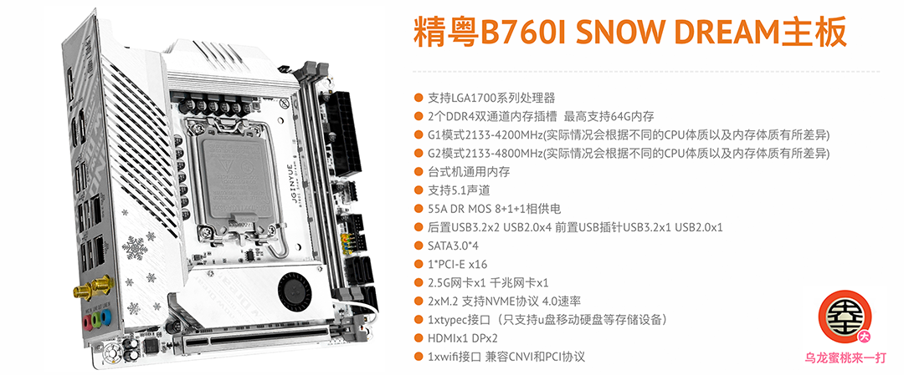

## JINGYUE B760I SNOW DREAM Hackintosh OpenCore EFI



### [简体中文](README.zh_CN.md)

### OpenCore

[OpenCore 1.0.7](https://github.com/acidanthera/OpenCorePkg)

### OS Version Tested

- macOS Monterey 12.x
- macOS Ventura    13.x
- macOS Sonoma   14.x
- macOS Sequoia   15.x
- macOS Tahoe   26.x

### Main EFI Components

| Component | Version / configuration |
| --- | --- |
| OpenCore | 1.0.7 |
| Lilu | 1.7.3 |
| VirtualSMC | 1.3.8 |
| WhateverGreen | 1.7.1 |
| AppleALC | 1.9.8 |
| RestrictEvents | 1.1.7 |
| RealtekRTL8111 | 2.5.0 |
| LucyRTL8125Ethernet | 1.2.3 |
| USB map | SimpleUSBMap 1.0.2 |
| Broadcom Wi-Fi compatibility | AMFIPass 1.4.1, IOSkywalkFamily and IO80211FamilyLegacy |

### Hardware

- Motherboard: B760
- Bios Version: JYI76009 06/06/2023
- CPU: Intel 13th i5-13400
- RAM: KingBank 32GB DDR4 3600Mhz
- SSD: Fanxiang S790 1TB Windows
- SSD: WD SN 770 1TB MacOS
- iGPU: Intel UHD Graphic 730 (Only work in Windows)
- GPU: Sapphire Radeon RX 570 8GB GDDR5
- Audio: Realtek ALC897
- Ethernet Card: Realtek RTL8125 Gaming 2.5GbE
- Ethernet Card: Realtek RTL8168H/8111H
- WIFI: BCM943602CS
- CASE: PCCOOLER Humming Bird i100 PRO
- PSU:  FSP MS 500W 80 BRONZE

### Notes

- After installation, use [OCAuxiliaryTools](https://github.com/ic005k/OCAuxiliaryTools) to generate your own SMBIOS information. Do not reuse the example identity in `config.plist`.
- If you use a CPU without Efficient Cores, disable `Kernel -> Quirks -> ProvideCurrentCpuInfo` in `config.plist`.
- The included Wi-Fi configuration targets the BCM943602CS listed below. On macOS Sonoma 14 and later, it uses `IOSkywalkFamily.kext`, `IO80211FamilyLegacy.kext` and `AMFIPass.kext`; the required root patches can be applied with [OpenCore Legacy Patcher](https://github.com/dortania/OpenCore-Legacy-Patcher).
- The current configuration contains the compatibility boot argument `-lilubetaall` for newer macOS versions. Remove it after all related Kexts officially support the macOS version you use.
- USB mapping now uses `SimpleUSBMap.kext`; the previous `USBToolBox.kext` and `UTBMap.kext` are no longer used.

### Bios Setup

```
Advanced
  |-- CPU Configuration
     |-- CPU Lock Configuration
	      |-- CFG Lock ：Disabled
	      
	Re-Size BAR Support：Disabled
           
  |-- CSM Configuration
     |-- CSM Support ：Disabled

BOOT
   |-- Secure Boot
      |-- Secure Boot ：Disabled 
```

### Contact Us

QQ Group: 23304408


### Tools
- [OpenCore-Legacy-Patcher](https://github.com/dortania/OpenCore-Legacy-Patcher)
- [Hackintool](https://github.com/headkaze/Hackintool) 
- [OCAuxiliaryTools](https://github.com/ic005k/OCAuxiliaryTools) AKA `OCAT`.
- [OpenCore Configurator](https://mackie100projects.altervista.org/opencore-configurator/) AKA `OCC`.
- [gibMacOS](https://github.com/corpnewt/gibMacOS) Build your own MacOS image.
- [ProperTree](https://github.com/corpnewt/ProperTree) Plist editor.
